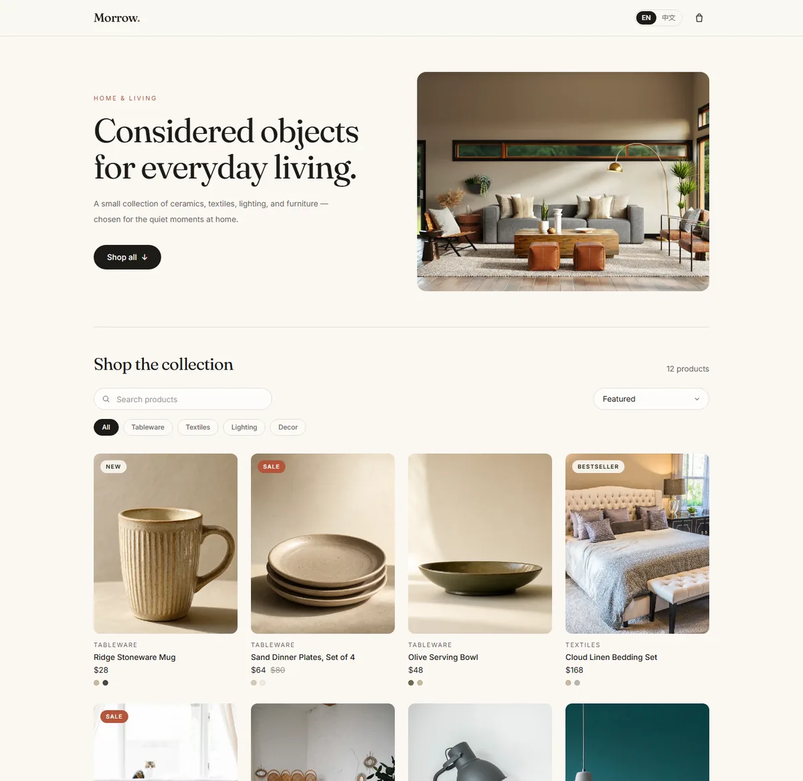

# Morrow — 家居选物商店

面向海外消费者的商品选购 Demo：12 件家居商品，支持中英文浏览、搜索筛选、查看详情、选择色号并加入购物车。桌面与移动端共用一套响应式界面。

线上地址：<https://morrow-home-r60za7sywlh.qoder.zone/>



## 功能

- **商品目录**：12 件商品，4 个分类（餐具、织物、灯具、饰品），4/3/2 列响应式网格。
- **搜索与筛选**：中英文关键词搜索（同时匹配英文名、中文名、slug）、分类筛选、Featured/价格升降序三种排序。筛选状态写入 URL（`?q=&category=&sort=`），刷新或分享链接都能还原。
- **商品详情**：双图画册与缩略图切换、色号选择、售罄色号禁用并标注、促销价对比、加购提示。移动端底部固定加购条。
- **购物车**：同一商品的不同色号分成独立行；每行数量 1–10；行小计与订单小计；移除商品；空购物车状态。数据存入 `localStorage`，刷新不丢失，存储损坏时安全回退为空车。
- **双语**：EN / 中文即时切换，选择持久化，并同步 `<html lang>`。
- **细节**：404 页面、跳过导航链接、`aria-live` 结果播报、可见焦点样式、`prefers-reduced-motion` 适配。

## 技术栈

Vite 8、React 19、TypeScript 6、Tailwind CSS 4、React Router 7、oxlint。没有 UI 组件库、状态管理库或 i18n 框架，交互部分全部手写。

## 本地运行

要求 Node.js 22+、pnpm 10（可通过 `corepack enable` 启用）。

```bash
pnpm install
pnpm dev          # http://localhost:5173
pnpm build        # tsc -b && vite build，输出到 dist/
pnpm preview      # 预览生产构建
pnpm lint         # oxlint
```

手机真机调试可用 `pnpm dev --host`。

## 目录结构

```text
src/
  cart/CartContext.tsx        # 购物车状态、持久化与派生金额
  components/                 # 页头、商品卡、数量步进器、Toast、语言与购物车入口
  data/products.ts            # 商品与分类数据、筛选与排序
  i18n/                       # 类型安全的中英文字典与 Provider
  lib/format.ts               # USD 价格格式化
  pages/                      # 首页、商品详情、购物车、404
  App.tsx / main.tsx          # 路由与 Provider 组合
docs/
  screenshots/                # 桌面与移动端截图
  agents/                     # issue tracker、分诊标签、领域文档约定
DELIVERY.md                   # 交付说明：范围、验证记录、取舍、录制建议
CONTEXT.md                    # 领域术语表
```

## 实现要点

- **URL 是筛选状态的唯一来源**：输入搜索词时使用 `replace` 导航，避免每个字符都进入浏览器历史。
- **购物车行以 `productId + colorId` 为键**：加购同款同色会累加数量，同款不同色保持两行；数量在 reducer 中夹在 1–10。
- **持久化前先校验**：读取 `localStorage` 时过滤非法商品/色号，去重并限制数量，解析失败直接回退为空车。
- **i18n 无第三方依赖**：字典以英文 key 集合生成中文类型，缺 key 会编译报错；只支持 `{name}` 形式的插值。
- **图片本地化**：所有图片放在 `public/images/`，使用 WebP 并声明尺寸，首屏图 `fetchPriority="high"`，卡片图懒加载。

## 数据与素材

商品、价格、库存状态均为演示数据，不对应真实 SKU。

图片共 21 张：其中 18 张来自 [Unsplash](https://unsplash.com/)（Unsplash License），3 张餐具图由 AI 生成（ImageGen），统一裁切并转为 WebP，总计约 2 MB。

## 已知限制

- 无后端、登录、库存校验与真实支付；购物车只存在当前浏览器。
- 金额仅计算商品小计，不含运费和税费，统一以 USD 显示。
- 搜索是本地包含匹配，当前数据量下即时；数据规模变大后需要索引或服务端搜索。
- 没有自动化测试，验证方式见 `DELIVERY.md`。

## 验证

`pnpm build` 通过；`pnpm lint` 无错误（3 条 React Fast Refresh 提示，来自 Context 与 hook 同文件导出）。桌面 1440px 与移动 390px 均无横向溢出，主要选购链路已在无头 Chrome 中逐项验证，记录见 [DELIVERY.md](DELIVERY.md)。
